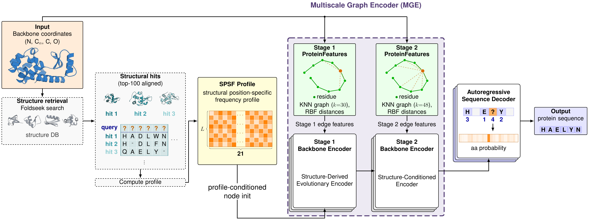

# FoldMapper

Inverse folding with structural position-specific frequency (SPSF) profiles.



FoldMapper is a multiscale graph neural network for protein inverse folding.
Foldseek retrieves structural homologues of the query backbone, and the top 100
aligned hits are accumulated into an `L x 21` structural position-specific
frequency (SPSF) profile. The Multiscale Graph Encoder (MGE) builds two
k-nearest-neighbour graphs over the same backbone: Stage 1 (`k=30`) initialises
its node features from the profile, while Stage 2 (`k=48`) conditions on
backbone geometry alone and feeds the autoregressive decoder that samples the
sequence. The figure is Fig. 1 of the paper; click to enlarge.

## Contents

- [Installation](#installation)
- [Quickstart](#quickstart)
- [Model variants](#model-variants)
- [Design tasks](#design-tasks)
- [Training](#training)
- [Reproducing paper tables](#reproducing-paper-tables)
- [Data](#data)
- [Citation](#citation)
- [License and attribution](#license-and-attribution)

## Installation

Requires Python 3.9+ and PyTorch 2.3.1 (CUDA 12.1 tested).

```bash
conda env create -f environment.yml
conda activate foldmapper
pip install -e .
```

### Foldseek database

Every SPSF profile comes from a Foldseek search, so unless you are given
precomputed profiles you also need the database.

`environment.yml` already installs the Foldseek binary (v10 or newer); if you
installed some other way, `conda install -c bioconda foldseek`. The PDB100
database itself is not redistributed here — fetch it once from the upstream
source:

```bash
foldseek databases PDB100 /path/to/db tmp  # ~20 GB
```

FoldMapper is trained and evaluated against this official PDB100 database.

## Quickstart

Sample sequences for a single-chain backbone. Any of the four checkpoints
works; see [Model variants](#model-variants) below.

```bash
# 1. Build the SPSF profile with Foldseek
bash scripts/make_profile.sh input.pdb /path/to/foldseek_db/pdb profiles/

# 2. Sample 100 sequences at temperature 0.1
python scripts/sample.py \
    --pdb input.pdb \
    --profile profiles/input.npy \
    --checkpoint /path/to/foldmapper_d256_blosum.pt \
    --n-samples 100 \
    --temperature 0.1 \
    --output-fasta samples.fasta
```

`sample.py` also accepts `--foldseek-db DB` instead of `--profile`, in which
case the profile is generated on the fly. If neither is supplied, the model
runs in backbone-only mode (the same regime triggered by `profile_dropout`
during training).

## Model variants

| Paper label             | `d_s1` | BLOSUM62 Stage-1 bias | Config                     |
|-------------------------|-------:|-----------------------|----------------------------|
| FoldMapper-29.5M        |    256 | off                   | `configs/d256.yaml`        |
| FoldMapper-40.0M        |    512 | off                   | `configs/d512.yaml`        |
| FoldMapper-29.5M+BLOSUM |    256 | on                    | `configs/d256_blosum.yaml` |
| FoldMapper-40.0M+BLOSUM |    512 | on                    | `configs/d512_blosum.yaml` |

Checkpoints are distributed separately. See
[`docs/checkpoints.md`](docs/checkpoints.md) for the variant ↔ Zenodo DOI
mapping.

## Design tasks

Beyond single-chain sampling, `examples/` holds one runnable script per
scenario — binder redesign, tied homo-oligomer design, and fixed-residue motif
scaffolding. See [`examples/README.md`](examples/README.md) for what each
script expects.

## Training

Reproduces the paper training run for any variant. The cluster splits, per-chain
metadata, and the pipeline that materializes the PDB/TED `.pt` shard tree are
distributed as a separate Zenodo record — see [Data](#data) below.

The shards that pipeline produces carry backbone coordinates and the native
sequence. FoldMapper additionally conditions on a cached SPSF profile, which
is not part of the dataset record — generate it before training:

```bash
# Run Foldseek once per shard first (same parameters as scripts/make_profile.sh;
# pinned Foldseek/PDB100 versions in docs/checkpoints.md), then attach profiles.
# --manifest is a newline-separated list of absolute .pt paths; each shard is
# rewritten under --output-dir at its path relative to --input-base, so the
# shard tree layout is preserved.
export SHARDS_WITH_PROFILE="${SUBSET_DIR}_with_profile"
find "${SUBSET_DIR}" -name '*.pt' > shards.txt
python scripts/make_profile_batch.py \
    --manifest shards.txt \
    --m8-dir <foldseek_results> \
    --input-base "${SUBSET_DIR}" \
    --output-dir "${SHARDS_WITH_PROFILE}"
```

Training silently falls back to a zero profile for any shard missing
`evo_profile`, so check the driver's summary counters (`missing .m8`,
`all-zero profiles`) rather than assuming success.

```bash
# Prereq: source the Zenodo training-data record's config.env, which exports
# SPLITS_DIR, METADATA_DIR, SUBSET_DIR, and FOLDMAPPER_DATA_BASE.
# Point the trainer at the profile-augmented tree produced above, not SUBSET_DIR.
export FOLDMAPPER_DATA_BASE="${SHARDS_WITH_PROFILE}"
python scripts/train.py \
    --config configs/d256_blosum.yaml \
    --path-for-training-data "${SPLITS_DIR}" \
    --ted-root "${SHARDS_WITH_PROFILE}/ted" \
    --ted-metadata "${METADATA_DIR}/ted_metadata.json" \
    --pdb-metadata "${METADATA_DIR}/pdb_metadata.json" \
    --path-for-outputs ./outputs \
    --use-wandb --wandb-project foldmapper
```

PDB shard paths are resolved via `pdb_metadata.json` + `FOLDMAPPER_DATA_BASE`;
TED shard paths combine `--ted-root` (for the initial existence check) with
`ted_metadata.json` (for sibling-domain lookup, also resolved through
`FOLDMAPPER_DATA_BASE`).

## Reproducing paper tables

Inference for the benchmarks in the paper (PDB/TED recovery, PPIBindBench,
scTM) is driven by the same `scripts/sample.py` — loop over test structures,
save profiles once, and sample 100 sequences per backbone at temperature 0.1.
Wrapper scripts will be added alongside the camera-ready release.

## Data

| Zenodo record | DOI |
|---|---|
| FoldMapper training data v1.0.0 | 10.5281/zenodo.24186409 |
| TEDMonoBench v1 | 10.5281/zenodo.24186015 |
| PPIBindBench v1 | 10.5281/zenodo.24186334 |
| FoldMapper checkpoints v1.0.0 | 10.5281/zenodo.24186465 |

The training-data record holds the cluster splits, the per-chain metadata, and
the data-prep pipeline that materializes the `.pt` shard tree from PDB + TED
sources. The shards themselves are regenerated from public PDB + TED sources
and contain backbone coords and the native sequence. The `evo_profile` tensor
(the SPSF profile) consumed by the trainer is FoldMapper-specific and is
produced by `scripts/make_profile_batch.py` in Foldseek AA order
(`A C D E F G H I K L M N P Q R S T V W Y X`).

## Citation

If you use FoldMapper, please cite the preprint:

> Kim, H. and Lee, J. FoldMapper: Protein Inverse Folding Model with
> Structure-Derived Evolutionary Profiles and a Multiscale Graph Encoder.
> *bioRxiv* (2026). doi:[10.64898/2026.11.15.766879](https://doi.org/10.64898/2026.11.15.766879)

```bibtex
@article{kim2026foldmapper,
  title   = {{FoldMapper}: Protein Inverse Folding Model with Structure-Derived
             Evolutionary Profiles and a Multiscale Graph Encoder},
  author  = {Kim, Haelyn and Lee, Juyong},
  journal = {bioRxiv},
  year    = {2026},
  doi     = {10.64898/2026.11.15.766879}
}
```

`CITATION.cff` carries the same reference in machine-readable form.

## License and attribution

FoldMapper is released under the Apache License 2.0 (`LICENSE`). Portions
are adapted from [ProteinMPNN](https://github.com/dauparas/ProteinMPNN)
(Dauparas et al., 2022) under the MIT License; see `NOTICE` for details.
